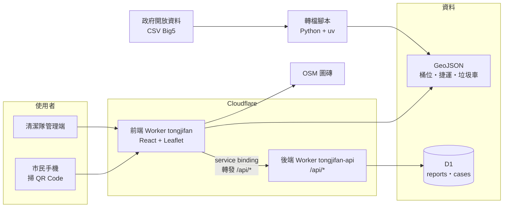
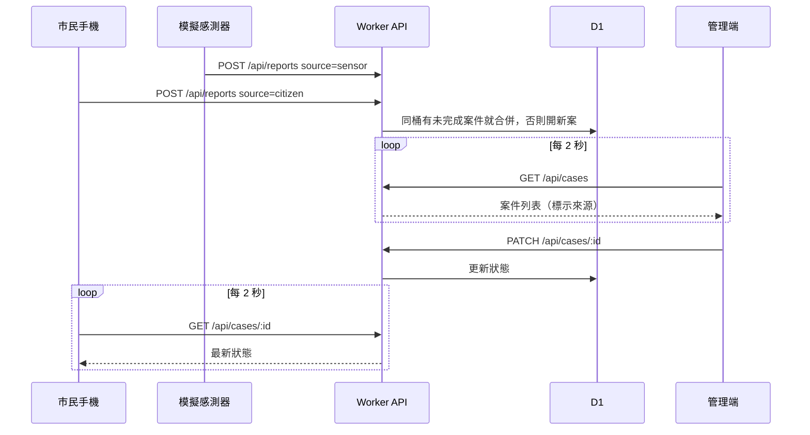

# 桶緝犯：系統架構

前後端分成兩個 Cloudflare Worker：前端 Worker 提供靜態網站，並把 `/api/*` 透過 service binding 轉給後端 Worker；後端 Worker 存取 D1。對外只有一個網址，前端每 2 秒輪詢。不用 Supabase、Vercel，也不用即時推播。

範圍與功能優先順序見 [桶緝犯_作戰計畫.md](桶緝犯_作戰計畫.md) 第 2 節。

## 為什麼這樣選

只有 P0「滿溢回報到處理完成」需要跨裝置共用資料：手機回報後管理端要看到，管理端完成後手機要更新（作戰計畫第 2 節 Demo 成功標準第 2、3 條）。容量地圖、候選點、家用垃圾指引都只讀靜態資料，不需要後端。

所以後端只做這一件事，並選擇服務數最少的做法：

| 考慮過的做法 | 結論 | 原因 |
|---|---|---|
| Supabase + Vercel（作戰計畫原本的建議） | 不用 | 不用寫伺服器，但要設定 RLS、publication、金鑰與兩個平台的環境變數；設定量比程式碼多。Vercel Hobby 方案沒有團隊協作功能 |
| Supabase Realtime 即時推播 | 不用 | 每 2 秒輪詢在現場 Demo 看起來一樣即時，省掉 publication 與 RLS select 設定 |
| 完全不要後端（單機左右並排 Demo） | 不用 | 現場無法用手機掃 QR Code 回報，失去 Demo 最有說服力的一段 |
| **Cloudflare Worker + D1** | **採用** | 一個網址、一個平台；API 只有四條路由 |
| 前後端兩個 Worker 各自對外，前端跨網域呼叫 API | 不用 | 要設定 CORS 與 API 網址環境變數，提交與 Demo 要處理兩個網址；改用 service binding 轉發就只有一個網址 |

## 技術組合

| 層 | 選擇 | 備註 |
|---|---|---|
| 前端 | Vite 8、React 19、TypeScript | `frontend/`；市民端（`src/citizen/`）與管理端（`src/admin/`）是同一份程式的兩個路由 |
| 地圖 | react-leaflet 5、Leaflet 1.9.4 | react-leaflet 5 要求 React 19 與 Leaflet ^1.9 |
| 底圖 | OpenFreeMap Positron | 樣式 `https://tiles.openfreemap.org/styles/positron`，用 `@maplibre/maplibre-gl-leaflet` 畫在 Leaflet 上。署名由圖磚帶入：OpenFreeMap、© OpenMapTiles、OpenStreetMap |
| 後端 | Cloudflare Worker | `backend/`；只處理 `/api/*`，不放靜態檔 |
| 資料庫 | Cloudflare D1 | 只存回報與案件 |
| 靜態資料 | GeoJSON，Python（uv）轉檔 | `data/bins.json`，前端畫地圖、後端驗證 `bin_id`，不進資料庫 |
| 工具 | bun、cf CLI | |

版本為 2026-10-23 在 npm 上的最新版。

## 系統架構

## P0 流程

模擬感測器是管理端的一個按鈕，呼叫和民眾回報同一支 API，只是 `source` 不同。

## API

| 方法與路徑 | 輸入 | 輸出 | 錯誤 |
|---|---|---|---|
| `POST /api/reports` | `bin_id`、`source`（`sensor`／`citizen`）、`kind`（`full`／`dirty`／`missing`） | 合併後或新開的案件 | `bin_id` 不存在或欄位值不合法回 400 |
| `GET /api/cases` | 選填 `status` | 案件列表，新的在前 | |
| `GET /api/cases/:id` | | 單一案件 | 不存在回 404 |
| `PATCH /api/cases/:id` | `status`（`assigned`／`done`） | 更新後的案件 | 狀態只能往前走（`open` → `assigned` → `done`），否則回 409 |

**合併規則**：同一個 `bin_id` 已有未完成（`open` 或 `assigned`）的案件時，新回報掛到那個案件上，不另開新案，避免重複派工。

## 資料

**D1 兩張表**

- `cases`：案件編號、`bin_id`、狀態、指派的清潔隊、開案／指派／完成時間。
- `reports`：回報編號、`case_id`、`source`、`kind`、時間。案件上顯示的「民眾 ×2」由這張表計算。

**靜態 GeoJSON**

- 臺北市行人專用清潔箱：全市 661 筆，北投區 0 筆，內容可能只到 2018 年。原始檔是 Big5 編碼；有一筆經緯度欄位互換、一筆經度寫成 `121.513.652`，轉檔時要修正。
- 開放資料沒有箱號，`bin_id` 由轉檔腳本依輸出順序編號，GeoJSON 檔進版控，編號就固定。QR Code 網址帶的是這個編號。
- 捷運車站出入口座標（Big5）、垃圾車點位、iTrash 據點，依 P1 進度加入。

**真實與模擬**

| 資料 | 真實或模擬 |
|---|---|
| 桶位、捷運站、垃圾車點位 | 真實（開放資料） |
| 剩餘容量 | 模擬，在前端計算 |
| 回報、案件、處理紀錄 | 模擬（現場 Demo 時即時產生） |

## 部署

| Worker | 資料夾 | 網址 | 綁定 |
|---|---|---|---|
| `tongjifan`（前端） | `frontend/` | https://tongjifan.nick12703990.workers.dev | `API` → `tongjifan-api` |
| `tongjifan-api`（後端） | `backend/` | 不對外使用，只經由前端轉發 | `DB` → D1 `tongjifan` |

- 前端設定 `assets.notFoundHandling: "single-page-application"` 與 `assets.runWorkerFirst: ["/api/*"]`：`/api/*` 進前端 Worker，由它 `env.API.fetch(req)` 原樣轉給後端，其餘路由回傳前端檔案（[Static Assets 路由](https://developers.cloudflare.com/workers/static-assets/routing/single-page-application/)）。
- 設定檔是各資料夾的 `cloudflare.config.ts`（`cf` 的 TypeScript 格式，不是 `wrangler.jsonc`）。`cf` 是 beta，D1 migrations 與 Wrangler 相容。
- 資料表用 D1 migrations 建立（`backend/migrations/`），部署用 `cf deploy`。指令見 [backend/README.md](backend/README.md) 與 [frontend/README.md](frontend/README.md)。
- 新的 Worker 第一次部署後約 5 分鐘內會間歇回 `error code: 1042`，之後穩定；重新部署不會再出現。所以兩個 Worker 要在 Demo 前一晚先部署好。
- 本機開發要同時跑前後端兩個 dev server，前端才轉發得到本機後端；只跑前端時 `/api/*` 回 503。

## 待確認

- repo 目前是私人的，作品提交前要改成公開（作戰計畫第 6 節）。
- 底圖若要換成 CARTO 淺色底圖，需要申請 API key（2026-09-23 起點陣底圖要求金鑰），並同時標示 © OpenStreetMap 與 © CARTO（[CARTO Basemaps FAQ](https://docs.carto.com/faqs/carto-basemaps)）。
